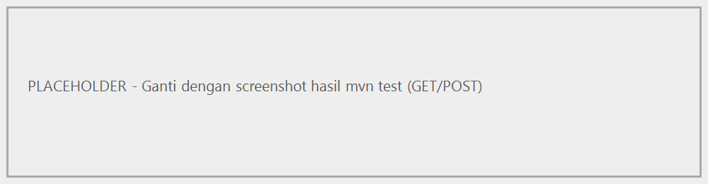
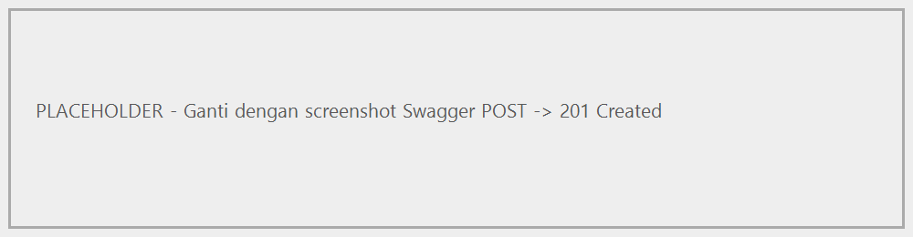
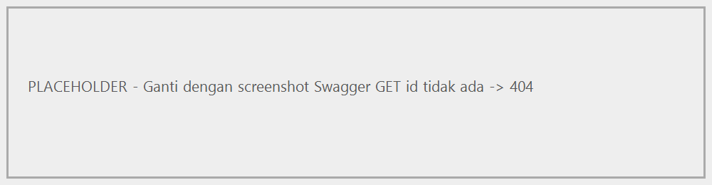
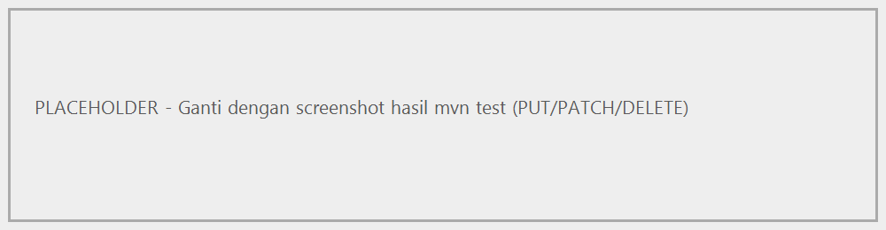
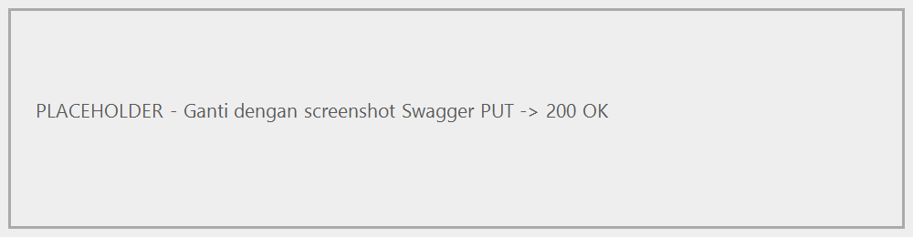
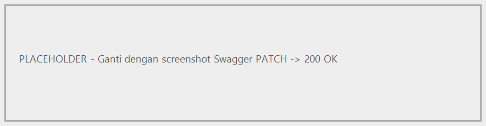
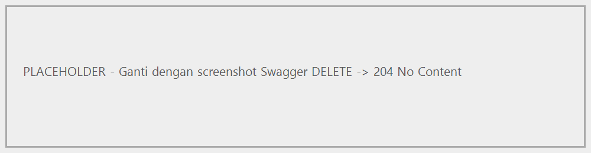
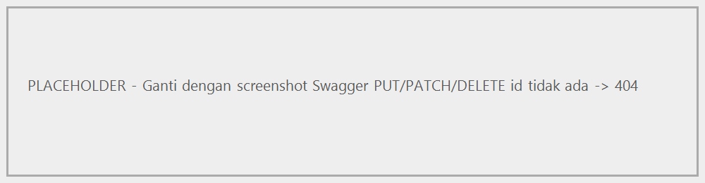

# UNIVERSITAS BRAWIJAYA
## FAKULTAS ILMU KOMPUTER

**PROJECT ARSITEKTUR BERBASIS LAYANAN**  
**TAHUN AKADEMIK 2026/2027 GENAP**

---

# TOURNEX: SISTEM PENGELOLAAN TURNAMEN ESPORTS BERBASIS MICROSERVICES

* **Dosen Pengampu:** Agi Putra Kharisma
* **Nama Kelompok:** Kapal Lompat

### Anggota Kelompok:
1. **Faris Dian Pradipta** — `235150200111068`
2. **Alarik Muhamad Nakharry** — `235150200111071`
3. **I Gede Ikhsa Garbhacita NP** — `235150207111072`

---

## DISCLAIMER PENGGUNAAN AI

Kami menggunakan teknologi Artificial Intelligence (AI) sebagai bantuan dalam proses penyusunan laporan, pengembangan proyek *Game Tournament Management API*, termasuk dalam perencanaan, mencari ide, menulis dokumen, serta memahami dan menerapkan sistem tersebut. AI digunakan dengan bijak dan bertanggung jawab untuk membantu proses belajar serta menyelesaikan proyek. Hasil yang dihasilkan dengan bantuan AI dicek, diperiksa, dan disesuaikan oleh tim sesuai dengan kebutuhan proyek serta pemahaman terhadap materi kuliah.

Tim bertanggung jawab atas semua isi laporan, penerapan sistem, hasil uji coba, serta setiap keputusan teknis yang dibuat. Penggunaan AI tidak menghilangkan tanggung jawab tim untuk memahami dan menjelaskan hasil pekerjaan yang diperoleh. Tim juga bertekad untuk menghindari menjiplak, menyebutkan sumber-sumber yang digunakan, serta mengikuti aturan akademik dan kebijakan penggunaan AI yang ditentukan oleh dosen pengampu. Pernyataan ini dibuat untuk menunjukkan bahwa AI digunakan secara bertanggung jawab dalam mengerjakan proyek tersebut.

**Malang, 22 Oktober 2026**  
*(Tanda Tangan)*  
**Alarik Muhamad Nakharry**  
`235150200111071`

---

## LATAR BELAKANG & MOTIVASI

Perkembangan industri gim telah mendorong munculnya berbagai kegiatan kompetitif, salah satunya melalui penyelenggaraan turnamen gim. Dalam gim VALORANT, kompetisi merupakan salah satu bagian penting dari ekosistem permainan, yang ditunjukkan melalui penyelenggaraan turnamen profesional seperti *VALORANT Champions Tour (VCT)*. Sistem pengelolaan turnamen menjadi aspek penting yang mendukung penyelenggaraan kompetisi, mulai dari penyediaan informasi turnamen, pengelolaan tim peserta, penjadwalan pertandingan, hingga pencatatan hasil pertandingan.

Berdasarkan ketertarikan tim terhadap ekosistem kompetitif VALORANT, muncul motivasi untuk merancang sistem pengelolaan turnamen yang dapat menjadi alternatif dari sistem yang telah tersedia. Sistem yang dikembangkan diharapkan dapat menyediakan pengelolaan informasi turnamen, data tim, jadwal pertandingan, serta hasil pertandingan secara terstruktur dan terintegrasi. Melalui perancangan ini, tim ingin mengeksplorasi bagaimana sebuah sistem dapat dikembangkan dengan fitur dan alur pengelolaan yang sesuai dengan kebutuhan pengguna, sekaligus memiliki potensi untuk dikembangkan lebih lanjut.

Berdasarkan motivasi tersebut, dirancang sebuah proyek bernama **Game Tournament Management API**, yaitu sistem berbasis REST API yang ditujukan untuk mendukung pengelolaan data turnamen gim. Sistem ini dirancang dengan membagi tanggung jawab ke dalam beberapa layanan, yaitu:
* **Tournament Service:** Mengelola informasi turnamen.
* **Team Service:** Mengelola data tim dan anggotanya.
* **Match Service:** Mengelola jadwal dan hasil pertandingan.

Melalui pengembangan proyek ini, tim berharap dapat menghasilkan fondasi sistem pengelolaan turnamen yang terstruktur, konsisten, dan mudah diintegrasikan dengan aplikasi lain. Selain bertujuan mengeksplorasi alternatif sistem pengelolaan turnamen yang terinspirasi dari ekosistem kompetitif VALORANT, proyek ini juga menjadi sarana penerapan konsep arsitektur berbasis layanan melalui perancangan REST API, dokumentasi menggunakan OpenAPI, pengujian otomatis, serta pengelolaan versi API dengan perubahan kontrak yang terencana (*breaking changes*).

---

## DOKUMENTASI DAN SPESIFIKASI API VERSI 1.0 DALAM BENTUK OPENAPI (GET, POST)

Dokumentasi API versi 1.0 disusun menggunakan *OpenAPI Specification* (OAS) untuk menjelaskan kontrak REST API dalam sistem pengelolaan turnamen gim VALORANT. Dokumentasi mencakup endpoint, metode HTTP, format request dan response, serta kode status HTTP.

Pada tahap awal, API difokuskan pada metode **GET** untuk mengambil data dan **POST** untuk menambahkan data baru. Sistem dirancang menggunakan arsitektur microservices dengan tiga layanan utama:
* Tournament Service
* Team Service
* Match Service

### Rancangan Endpoint API Versi 1.0 (GET & POST)

| Layanan | Metode | Endpoint | Fungsi |
| :--- | :--- | :--- | :--- |
| Tournament | GET | `/api/v1/tournaments` | Melihat daftar turnamen |
| Tournament | POST | `/api/v1/tournaments` | Menambah turnamen |
| Team | GET | `/api/v1/teams` | Melihat daftar tim |
| Team | POST | `/api/v1/teams` | Menambah tim |
| Match | GET | `/api/v1/matches` | Melihat daftar pertandingan |
| Match | POST | `/api/v1/matches` | Menambah pertandingan |

OpenAPI digunakan untuk mendeskripsikan kontrak REST API secara terstruktur, termasuk endpoint, metode HTTP, skema data, dan respons. Dokumentasi dapat ditampilkan melalui Swagger UI agar spesifikasi lebih mudah dipahami dan endpoint dapat dicoba secara interaktif.

Spesifikasi API versi 1.0 disiapkan dalam format YAML atau JSON sebagai acuan implementasi dan pengujian. Spesifikasi ini juga menjadi dasar pengembangan versi berikutnya yang akan menerapkan perubahan kontrak tidak kompatibel (*breaking changes*).

---

## DOKUMENTASI DAN SPESIFIKASI API VERSI 1.0 DALAM BENTUK OPENAPI (PUT, PATCH, DELETE)

Dokumentasi API versi 1.0 dilengkapi dengan metode HTTP **PUT**, **PATCH**, dan **DELETE** untuk mendukung pengelolaan data pada sistem TOURNEX. 
* **PUT:** Used to update the entirety of a resource's data.
* **PATCH:** Used to update a portion of a resource's data.
* **DELETE:** Used to delete data based on its identity.

Endpoint dirancang mengikuti pembagian tanggung jawab tiga layanan, yaitu Tournament Service, Team Service, dan Match Service. Spesifikasi ini melengkapi metode GET dan POST yang telah dirancang sebelumnya, sehingga setiap layanan memiliki rancangan operasi untuk membaca, menambahkan, memperbarui, dan menghapus data.

### Rancangan Endpoint API Versi 1.0 (PUT, PATCH, DELETE)

| Layanan | Metode | Endpoint | Fungsi |
| :--- | :--- | :--- | :--- |
| Tournament | PUT | `/api/v1/tournaments/{id}` | Memperbarui seluruh data turnamen |
| Tournament | PATCH | `/api/v1/tournaments/{id}` | Memperbarui sebagian data turnamen |
| Tournament | DELETE | `/api/v1/tournaments/{id}` | Menghapus turnamen |
| Team | PUT | `/api/v1/teams/{id}` | Memperbarui seluruh data tim |
| Team | PATCH | `/api/v1/teams/{id}` | Memperbarui sebagian data tim |
| Team | DELETE | `/api/v1/teams/{id}` | Menghapus tim |
| Match | PUT | `/api/v1/matches/{id}` | Memperbarui seluruh data pertandingan |
| Match | PATCH | `/api/v1/matches/{id}` | Memperbarui sebagian data pertandingan |
| Match | DELETE | `/api/v1/matches/{id}` | Menghapus pertandingan |

Spesifikasi OpenAPI mendeskripsikan setiap operasi melalui path, metode HTTP, parameter identitas sumber daya, format data permintaan, dan respons yang mungkin dihasilkan. Operasi pembaruan menggunakan parameter ID untuk menentukan data yang akan diubah, sedangkan operasi penghapusan menggunakan ID untuk menentukan data yang akan dihapus.

### Kode Status HTTP yang Direncanakan:
* **`200 OK` / `204 No Content`:** Operasi berhasil.
* **`400 Bad Request`:** Permintaan tidak valid.
* **`404 Not Found`:** Data tidak ditemukan.
* **`500 Internal Server Error`:** Kesalahan pada server.

Rancangan OpenAPI ini menjadi acuan implementasi dan pengujian API versi 1.0. Detail skema permintaan, respons, serta perilaku setiap endpoint akan disesuaikan dengan model data dan implementasi masing-masing layanan.

---

## BUILD PROPERTIES

### Parent POM (`pom.xml`)

```xml
<project xmlns="http://maven.apache.org/POM/4.0.0"
         xmlns:xsi="http://www.w3.org/2001/XMLSchema-instance"
         xsi:schemaLocation="http://maven.apache.org/POM/4.0.0 https://maven.apache.org/xsd/maven-4.0.0.xsd">
  <modelVersion>4.0.0</modelVersion>

  <groupId>id.tournex</groupId>
  <artifactId>tournex-parent</artifactId>
  <version>1.0.0</version>
  <packaging>pom</packaging>

  <modules>
    <module>tournament-service</module>
    <module>team-service</module>
    <module>match-service</module>
  </modules>

  <properties>
    <java.version>17</java.version>
    <spring-boot.version>3.5.6</spring-boot.version>
    <maven.compiler.release>17</maven.compiler.release>
    <project.build.sourceEncoding>UTF-8</project.build.sourceEncoding>
  </properties>

  <dependencyManagement>
    <dependencies>
      <dependency>
        <groupId>org.springframework.boot</groupId>
        <artifactId>spring-boot-dependencies</artifactId>
        <version>${spring-boot.version}</version>
        <type>pom</type>
        <scope>import</scope>
      </dependency>
    </dependencies>
  </dependencyManagement>

  <build>
    <pluginManagement>
      <plugins>
        <plugin>
          <groupId>org.springframework.boot</groupId>
          <artifactId>spring-boot-maven-plugin</artifactId>
          <version>${spring-boot.version}</version>
          <executions>
            <execution>
              <goals>
                <goal>repackage</goal>
              </goals>
            </execution>
          </executions>
        </plugin>
        <plugin>
          <groupId>org.apache.maven.plugins</groupId>
          <artifactId>maven-compiler-plugin</artifactId>
          <version>3.14.0</version>
          <configuration>
            <release>17</release>
            <parameters>true</parameters>
          </configuration>
        </plugin>
      </plugins>
    </pluginManagement>
  </build>
</project>
```

Penjelasan:
* **Java 17** digunakan sebagai target kompilasi (`java.version` dan `maven.compiler.release`).
* **Spring Boot 3.5.6** digunakan sebagai versi dependency melalui BOM `spring-boot-dependencies`.
* **`<parameters>true</parameters>`** wajib karena proyek tidak memakai `spring-boot-starter-parent`. Flag ini membuat nama parameter (`@PathVariable Long id`) tersedia saat runtime.
* **Goal `repackage`** pada `spring-boot-maven-plugin` membuat `mvn package` menghasilkan executable jar (fat jar).

### Module POM (`tournament-service/pom.xml`)

```xml
<project xmlns="http://maven.apache.org/POM/4.0.0"
         xmlns:xsi="http://www.w3.org/2001/XMLSchema-instance"
         xsi:schemaLocation="http://maven.apache.org/POM/4.0.0 https://maven.apache.org/xsd/maven-4.0.0.xsd">
  <modelVersion>4.0.0</modelVersion>

  <parent>
    <groupId>id.tournex</groupId>
    <artifactId>tournex-parent</artifactId>
    <version>1.0.0</version>
  </parent>

  <artifactId>tournament-service</artifactId>

  <dependencies>
    <dependency>
      <groupId>org.springframework.boot</groupId>
      <artifactId>spring-boot-starter-web</artifactId>
    </dependency>
    <dependency>
      <groupId>org.springframework.boot</groupId>
      <artifactId>spring-boot-starter-data-jpa</artifactId>
    </dependency>
    <dependency>
      <groupId>org.springframework.boot</groupId>
      <artifactId>spring-boot-starter-validation</artifactId>
    </dependency>
    <dependency>
      <groupId>com.h2database</groupId>
      <artifactId>h2</artifactId>
      <scope>runtime</scope>
    </dependency>
    <dependency>
      <groupId>org.springdoc</groupId>
      <artifactId>springdoc-openapi-starter-webmvc-ui</artifactId>
      <version>2.8.13</version>
    </dependency>
    <dependency>
      <groupId>org.springframework.boot</groupId>
      <artifactId>spring-boot-starter-test</artifactId>
      <scope>test</scope>
    </dependency>
  </dependencies>

  <build>
    <plugins>
      <plugin>
        <groupId>org.springframework.boot</groupId>
        <artifactId>spring-boot-maven-plugin</artifactId>
      </plugin>
    </plugins>
  </build>
</project>
```

`team-service` dan `match-service` memiliki konfigurasi yang sama; perbedaannya hanya pada `artifactId`.

---

## KONFIGURASI DEPLOYMENT

### Tournament Service (`tournament-service/src/main/resources/application.properties`)

```properties
spring.application.name=tournament-service
server.port=8081
spring.datasource.url=jdbc:h2:mem:tournamentdb;DB_CLOSE_DELAY=-1;DB_CLOSE_ON_EXIT=FALSE
spring.datasource.driver-class-name=org.h2.Driver
spring.datasource.username=sa
spring.datasource.password=
spring.jpa.hibernate.ddl-auto=create-drop
spring.jpa.open-in-view=false
spring.h2.console.enabled=true
spring.h2.console.path=/h2-console
springdoc.swagger-ui.path=/swagger-ui.html
```

### Team Service (`team-service/src/main/resources/application.properties`)

```properties
spring.application.name=team-service
server.port=8082
spring.datasource.url=jdbc:h2:mem:teamdb;DB_CLOSE_DELAY=-1;DB_CLOSE_ON_EXIT=FALSE
spring.datasource.driver-class-name=org.h2.Driver
spring.datasource.username=sa
spring.datasource.password=
spring.jpa.hibernate.ddl-auto=create-drop
spring.jpa.open-in-view=false
spring.h2.console.enabled=true
spring.h2.console.path=/h2-console
springdoc.swagger-ui.path=/swagger-ui.html
```

### Match Service (`match-service/src/main/resources/application.properties`)

```properties
spring.application.name=match-service
server.port=8083
spring.datasource.url=jdbc:h2:mem:matchdb;DB_CLOSE_DELAY=-1;DB_CLOSE_ON_EXIT=FALSE
spring.datasource.driver-class-name=org.h2.Driver
spring.datasource.username=sa
spring.datasource.password=
spring.jpa.hibernate.ddl-auto=create-drop
spring.jpa.open-in-view=false
spring.h2.console.enabled=true
spring.h2.console.path=/h2-console
springdoc.swagger-ui.path=/swagger-ui.html
```

### CI/CD (`.github/workflows/maven.yml`)

```yaml
name: TOURNEX Maven CI
on:
  push:
    branches: [ "main", "master" ]
  pull_request:
    branches: [ "main", "master" ]
jobs:
  test:
    runs-on: ubuntu-latest
    steps:
      - uses: actions/checkout@v4
      - name: Set up JDK 17
        uses: actions/setup-java@v4
        with:
          java-version: '17'
          distribution: 'temurin'
          cache: maven
      - name: Run tests
        run: mvn --batch-mode clean verify
```

### Cara menjalankan

```bash
# build dan test seluruh modul
mvn clean test
# atau memakai Maven Wrapper
.\mvnw.cmd clean test

# menjalankan service
mvn -pl tournament-service spring-boot:run
mvn -pl team-service spring-boot:run
mvn -pl match-service spring-boot:run

# atau memakai Maven Wrapper (Windows)
.\mvnw.cmd -pl tournament-service spring-boot:run
.\mvnw.cmd -pl team-service spring-boot:run
.\mvnw.cmd -pl match-service spring-boot:run
```

| Service | Port | Swagger UI | OpenAPI JSON | H2 Console |
| :--- | ---: | :--- | :--- | :--- |
| Tournament | 8081 | `http://localhost:8081/swagger-ui.html` | `http://localhost:8081/v3/api-docs` | `http://localhost:8081/h2-console` |
| Team | 8082 | `http://localhost:8082/swagger-ui.html` | `http://localhost:8082/v3/api-docs` | `http://localhost:8082/h2-console` |
| Match | 8083 | `http://localhost:8083/swagger-ui.html` | `http://localhost:8083/v3/api-docs` | `http://localhost:8083/h2-console` |

Spesifikasi OpenAPI statis hasil ekspor juga tersedia di direktori `docs/openapi/`:
* `docs/openapi/tournament-service.json`
* `docs/openapi/team-service.json`
* `docs/openapi/match-service.json`

---

## KODE SUMBER UTAMA — GET & POST

### `TournamentController.java`

```java
@RestController
@RequestMapping("/api/v1/tournaments")
@Tag(name = "Tournament API", description = "Operasi API Tournament versi 1.0")
public class TournamentController {

    private final TournamentRepository repository;
    private final Validator validator;

    public TournamentController(TournamentRepository repository, Validator validator) {
        this.repository = repository;
        this.validator = validator;
    }

    @GetMapping
    @Operation(summary = "Mengambil seluruh data tournament")
    @ApiResponses({
        @ApiResponse(responseCode = "200", description = "Daftar tournament berhasil diambil"),
        @ApiResponse(responseCode = "500", description = "Kesalahan pada server")
    })
    public List<Tournament> getAll() {
        return repository.findAll();
    }

    @GetMapping("/{id}")
    @Operation(summary = "Mengambil tournament berdasarkan ID")
    @ApiResponses({
        @ApiResponse(responseCode = "200", description = "Tournament ditemukan"),
        @ApiResponse(responseCode = "404", description = "Tournament tidak ditemukan"),
        @ApiResponse(responseCode = "500", description = "Kesalahan pada server")
    })
    public Tournament getById(@PathVariable Long id) {
        return findById(id);
    }

    @PostMapping
    @ResponseStatus(HttpStatus.CREATED)
    @Operation(summary = "Membuat tournament baru")
    @ApiResponses({
        @ApiResponse(responseCode = "201", description = "Tournament berhasil dibuat"),
        @ApiResponse(responseCode = "400", description = "Permintaan tidak valid"),
        @ApiResponse(responseCode = "500", description = "Kesalahan pada server")
    })
    public Tournament create(@Valid @RequestBody Tournament request) {
        request.setId(null);
        return repository.save(request);
    }

    private Tournament findById(Long id) {
        return repository.findById(id)
            .orElseThrow(() -> new ResponseStatusException(
                HttpStatus.NOT_FOUND, "Tournament dengan ID " + id + " tidak ditemukan"));
    }
}
```

`TeamController` dan `MatchController` mengikuti pola yang sama dengan entitas dan path masing-masing:

| Service | Path | Entity | Repository |
| :--- | :--- | :--- | :--- |
| Tournament | `/api/v1/tournaments` | `Tournament` | `TournamentRepository` |
| Team | `/api/v1/teams` | `Team` | `TeamRepository` |
| Match | `/api/v1/matches` | `Match` | `MatchRepository` |

### Repository

```java
public interface TournamentRepository extends JpaRepository<Tournament, Long> {}
public interface TeamRepository extends JpaRepository<Team, Long> {}
public interface MatchRepository extends JpaRepository<Match, Long> {}
```

### Ringkasan status GET & POST

| Method | Endpoint | Status sukses | Status gagal |
| :--- | :--- | :--- | :--- |
| GET | `/api/v1/{resources}` | `200 OK` | `500` |
| GET | `/api/v1/{resources}/{id}` | `200 OK` | `404`, `500` |
| POST | `/api/v1/{resources}` | `201 Created` | `400`, `500` |

---

## KODE SUMBER UTAMA — PUT, PATCH, DELETE

### `TournamentController.java`

```java
@PutMapping("/{id}")
@Operation(summary = "Mengganti seluruh data tournament")
@ApiResponses({
    @ApiResponse(responseCode = "200", description = "Tournament berhasil diperbarui"),
    @ApiResponse(responseCode = "400", description = "Permintaan tidak valid"),
    @ApiResponse(responseCode = "404", description = "Tournament tidak ditemukan"),
    @ApiResponse(responseCode = "500", description = "Kesalahan pada server")
})
public Tournament update(@PathVariable Long id, @Valid @RequestBody Tournament request) {
    Tournament existing = findById(id);
    existing.setName(request.getName());
    existing.setGameTitle(request.getGameTitle());
    existing.setDescription(request.getDescription());
    existing.setStatus(request.getStatus());
    existing.setStartDate(request.getStartDate());
    existing.setEndDate(request.getEndDate());
    return repository.save(existing);
}

@PatchMapping("/{id}")
@Operation(summary = "Memperbarui sebagian data tournament")
@ApiResponses({
    @ApiResponse(responseCode = "200", description = "Tournament berhasil diperbarui sebagian"),
    @ApiResponse(responseCode = "400", description = "Permintaan tidak valid"),
    @ApiResponse(responseCode = "404", description = "Tournament tidak ditemukan"),
    @ApiResponse(responseCode = "500", description = "Kesalahan pada server")
})
public Tournament patch(@PathVariable Long id, @RequestBody Tournament request) {
    Tournament existing = findById(id);
    if (request.getName() != null) existing.setName(request.getName());
    if (request.getGameTitle() != null) existing.setGameTitle(request.getGameTitle());
    if (request.getDescription() != null) existing.setDescription(request.getDescription());
    if (request.getStatus() != null) existing.setStatus(request.getStatus());
    if (request.getStartDate() != null) existing.setStartDate(request.getStartDate());
    if (request.getEndDate() != null) existing.setEndDate(request.getEndDate());
    validate(existing);
    return repository.save(existing);
}

@DeleteMapping("/{id}")
@ResponseStatus(HttpStatus.NO_CONTENT)
@Operation(summary = "Menghapus tournament berdasarkan ID")
@ApiResponses({
    @ApiResponse(responseCode = "204", description = "Tournament berhasil dihapus"),
    @ApiResponse(responseCode = "404", description = "Tournament tidak ditemukan"),
    @ApiResponse(responseCode = "500", description = "Kesalahan pada server")
})
public void delete(@PathVariable Long id) {
    repository.delete(findById(id));
}

private void validate(Tournament entity) {
    validator.validate(entity).stream().findFirst().ifPresent(violation -> {
        throw new ResponseStatusException(HttpStatus.BAD_REQUEST, violation.getMessage());
    });
}
```

### `TeamController.java`

```java
@PutMapping("/{id}")
public Team update(@PathVariable Long id, @Valid @RequestBody Team request) {
    Team existing = findById(id);
    existing.setName(request.getName());
    existing.setTag(request.getTag());
    existing.setGameTitle(request.getGameTitle());
    existing.setDescription(request.getDescription());
    return repository.save(existing);
}

@PatchMapping("/{id}")
public Team patch(@PathVariable Long id, @RequestBody Team request) {
    Team existing = findById(id);
    if (request.getName() != null) existing.setName(request.getName());
    if (request.getTag() != null) existing.setTag(request.getTag());
    if (request.getGameTitle() != null) existing.setGameTitle(request.getGameTitle());
    if (request.getDescription() != null) existing.setDescription(request.getDescription());
    validate(existing);
    return repository.save(existing);
}

@DeleteMapping("/{id}")
@ResponseStatus(HttpStatus.NO_CONTENT)
public void delete(@PathVariable Long id) {
    repository.delete(findById(id));
}

private void validate(Team entity) {
    validator.validate(entity).stream().findFirst().ifPresent(violation -> {
        throw new ResponseStatusException(HttpStatus.BAD_REQUEST, violation.getMessage());
    });
}
```

### `MatchController.java`

```java
@PutMapping("/{id}")
public Match update(@PathVariable Long id, @Valid @RequestBody Match request) {
    Match existing = findById(id);
    existing.setTournamentId(request.getTournamentId());
    existing.setTeamAId(request.getTeamAId());
    existing.setTeamBId(request.getTeamBId());
    existing.setScheduledAt(request.getScheduledAt());
    existing.setStatus(request.getStatus());
    existing.setWinnerTeamId(request.getWinnerTeamId());
    existing.setScoreTeamA(request.getScoreTeamA());
    existing.setScoreTeamB(request.getScoreTeamB());
    return repository.save(existing);
}

@PatchMapping("/{id}")
public Match patch(@PathVariable Long id, @RequestBody Match request) {
    Match existing = findById(id);
    if (request.getTournamentId() != null) existing.setTournamentId(request.getTournamentId());
    if (request.getTeamAId() != null) existing.setTeamAId(request.getTeamAId());
    if (request.getTeamBId() != null) existing.setTeamBId(request.getTeamBId());
    if (request.getScheduledAt() != null) existing.setScheduledAt(request.getScheduledAt());
    if (request.getStatus() != null) existing.setStatus(request.getStatus());
    if (request.getWinnerTeamId() != null) existing.setWinnerTeamId(request.getWinnerTeamId());
    if (request.getScoreTeamA() != null) existing.setScoreTeamA(request.getScoreTeamA());
    if (request.getScoreTeamB() != null) existing.setScoreTeamB(request.getScoreTeamB());
    validate(existing);
    return repository.save(existing);
}

@DeleteMapping("/{id}")
@ResponseStatus(HttpStatus.NO_CONTENT)
public void delete(@PathVariable Long id) {
    repository.delete(findById(id));
}

private void validate(Match entity) {
    validator.validate(entity).stream().findFirst().ifPresent(violation -> {
        throw new ResponseStatusException(HttpStatus.BAD_REQUEST, violation.getMessage());
    });
}
```

### Validasi model data

| Entity | Field | Constraint |
| :--- | :--- | :--- |
| `Tournament` | `name`, `gameTitle`, `status` | `@NotBlank` |
| `Tournament` | `startDate`, `endDate` | `@NotNull` |
| `Team` | `name`, `tag`, `gameTitle` | `@NotBlank` |
| `Match` | `tournamentId`, `teamAId`, `teamBId` | `@NotNull`, `@Positive` |
| `Match` | `scheduledAt` | `@NotNull` |
| `Match` | `status` | `@NotBlank` |

### Ringkasan status PUT, PATCH, DELETE

| Method | Endpoint | Status sukses | Status gagal |
| :--- | :--- | :--- | :--- |
| PUT | `/api/v1/{resources}/{id}` | `200 OK` | `400`, `404`, `500` |
| PATCH | `/api/v1/{resources}/{id}` | `200 OK` | `400`, `404`, `500` |
| DELETE | `/api/v1/{resources}/{id}` | `204 No Content` | `404`, `500` |

---

## PENGUJIAN API VERSI 1.0 (GET, POST)

Pengujian operasi GET dan POST dilakukan dengan dua pendekatan:

1. **Pengujian otomatis** menggunakan JUnit 5 dan `MockMvc` dengan anotasi `@SpringBootTest` dan `@AutoConfigureMockMvc`. Tes berjalan tanpa perlu menyalakan server dan memverifikasi kode status serta isi respons.
2. **Pengujian manual** melalui Swagger UI dengan fitur *Try it out*, atau melalui PowerShell/curl untuk memastikan perilaku endpoint secara nyata.

Setiap service memiliki 10 tes otomatis. Tiga di antaranya menguji operasi GET dan POST.

### Kode Sumber Pengujian

Berkas: `tournament-service/src/test/java/id/tournex/tournament/TournamentControllerTest.java`

```java
package id.tournex.tournament;

import com.jayway.jsonpath.JsonPath;
import org.junit.jupiter.api.Test;
import org.springframework.beans.factory.annotation.Autowired;
import org.springframework.boot.test.autoconfigure.web.servlet.AutoConfigureMockMvc;
import org.springframework.boot.test.context.SpringBootTest;
import org.springframework.http.MediaType;
import org.springframework.test.web.servlet.MockMvc;
import org.springframework.test.web.servlet.MvcResult;

import static org.springframework.test.web.servlet.request.MockMvcRequestBuilders.*;
import static org.springframework.test.web.servlet.result.MockMvcResultMatchers.*;

@SpringBootTest
@AutoConfigureMockMvc
class TournamentControllerTest {

    private static final String VALID_BODY = "{\"name\":\"TOURNEX Open\",\"gameTitle\":\"VALORANT\",\"description\":\"Community tournament\",\"status\":\"REGISTRATION\",\"startDate\":\"2026-12-01\",\"endDate\":\"2026-12-05\"}";

    @Autowired
    MockMvc mockMvc;

    @Test
    void getAllReturnsOk() throws Exception {
        mockMvc.perform(get("/api/v1/tournaments"))
            .andExpect(status().isOk())
            .andExpect(content().contentTypeCompatibleWith(MediaType.APPLICATION_JSON));
    }

    @Test
    void postCreatesResourceAndReturns201() throws Exception {
        mockMvc.perform(post("/api/v1/tournaments")
                .contentType(MediaType.APPLICATION_JSON)
                .content(VALID_BODY))
            .andExpect(status().isCreated())
            .andExpect(jsonPath("$.id").exists());
    }

    @Test
    void getUnknownIdReturns404() throws Exception {
        mockMvc.perform(get("/api/v1/tournaments/999999"))
            .andExpect(status().isNotFound());
    }
}
```

`TeamControllerTest` dan `MatchControllerTest` menggunakan struktur yang sama. Perbedaannya hanya pada path dan isi `VALID_BODY`:

| Service | Path | `VALID_BODY` |
| :--- | :--- | :--- |
| Tournament | `/api/v1/tournaments` | `{"name":"TOURNEX Open","gameTitle":"VALORANT","description":"Community tournament","status":"REGISTRATION","startDate":"2026-12-01","endDate":"2026-12-05"}` |
| Team | `/api/v1/teams` | `{"name":"Kapal Lompat","tag":"KPL","gameTitle":"VALORANT","description":"Peserta"}` |
| Match | `/api/v1/matches` | `{"tournamentId":1,"teamAId":1,"teamBId":2,"scheduledAt":"2026-12-01T19:00:00","status":"SCHEDULED"}` |

### Skenario dan Hasil Pengujian

| No | Skenario | Endpoint | Hasil yang diharapkan | Status |
| :-: | :--- | :--- | :--- | :--- |
| 1 | Mengambil seluruh data | `GET /api/v1/{resources}` | `200 OK`, respons JSON berupa array | Lulus |
| 2 | Menambah data baru | `POST /api/v1/{resources}` | `201 Created`, respons memiliki `id` | Lulus |
| 3 | Mengambil data dengan ID tidak ada | `GET /api/v1/{resources}/999999` | `404 Not Found` | Lulus |

Total: **3 tes × 3 service = 9 tes**, seluruhnya lulus.

### Hasil Pengujian Otomatis

Perintah:

```powershell
.\mvnw.cmd -B clean test
```

Keluaran yang diharapkan:

```
Tests run: 10, Failures: 0, Errors: 0, Skipped: 0 -- TournamentControllerTest
Tests run: 10, Failures: 0, Errors: 0, Skipped: 0 -- TeamControllerTest
Tests run: 10, Failures: 0, Errors: 0, Skipped: 0 -- MatchControllerTest
BUILD SUCCESS
```



*Gambar 1. Hasil `mvn test` untuk pengujian GET dan POST.*

### Hasil Pengujian Manual (Swagger UI)



*Gambar 2. POST `/api/v1/tournaments` berhasil dengan status `201 Created`.*


*Gambar 3. GET `/api/v1/tournaments` berhasil dengan status `200 OK`.*



*Gambar 4. GET `/api/v1/tournaments/999999` mengembalikan status `404 Not Found`.*

### Alternatif Pengujian Manual dengan PowerShell

```powershell
# GET seluruh data
Invoke-RestMethod http://localhost:8081/api/v1/tournaments | Format-Table

# POST data baru
$body = @{
  name        = "TOURNEX Invitational"
  gameTitle   = "Mobile Legends"
  description = "Uji coba"
  status      = "UPCOMING"
  startDate   = "2026-11-10"
  endDate     = "2026-11-12"
} | ConvertTo-Json

Invoke-RestMethod -Method Post `
  -Uri http://localhost:8081/api/v1/tournaments `
  -ContentType 'application/json' `
  -Body $body
```

---

## PENGUJIAN API VERSI 1.0 (PUT, PATCH, DELETE)

Pengujian operasi PUT, PATCH, dan DELETE menggunakan pendekatan yang sama dengan GET dan POST, yaitu tes otomatis berbasis `MockMvc` dan verifikasi manual melalui Swagger UI. Setiap service memiliki 10 tes, dan tujuh di antaranya menguji ketiga operasi tersebut.

### Kode Sumber Pengujian

Tes berikut berada pada kelas yang sama, yaitu `TournamentControllerTest`.

```java
    @Test
    void putUpdatesWholeResourceAndReturns200() throws Exception {
        long id = createTournament();
        mockMvc.perform(put("/api/v1/tournaments/" + id)
                .contentType(MediaType.APPLICATION_JSON)
                .content("{\"name\":\"TOURNEX Finals\",\"gameTitle\":\"CS2\",\"description\":\"Update penuh\",\"status\":\"ONGOING\",\"startDate\":\"2026-12-02\",\"endDate\":\"2026-12-06\"}"))
            .andExpect(status().isOk())
            .andExpect(jsonPath("$.id").value(id))
            .andExpect(jsonPath("$.name").value("TOURNEX Finals"))
            .andExpect(jsonPath("$.gameTitle").value("CS2"))
            .andExpect(jsonPath("$.status").value("ONGOING"));
    }

    @Test
    void putUnknownIdReturns404() throws Exception {
        mockMvc.perform(put("/api/v1/tournaments/999999")
                .contentType(MediaType.APPLICATION_JSON)
                .content(VALID_BODY))
            .andExpect(status().isNotFound());
    }

    @Test
    void patchUpdatesOnlyProvidedFieldsAndReturns200() throws Exception {
        long id = createTournament();
        mockMvc.perform(patch("/api/v1/tournaments/" + id)
                .contentType(MediaType.APPLICATION_JSON)
                .content("{\"status\":\"ONGOING\"}"))
            .andExpect(status().isOk())
            .andExpect(jsonPath("$.name").value("TOURNEX Open"))
            .andExpect(jsonPath("$.status").value("ONGOING"));
    }

    @Test
    void patchInvalidValueReturns400() throws Exception {
        long id = createTournament();
        mockMvc.perform(patch("/api/v1/tournaments/" + id)
                .contentType(MediaType.APPLICATION_JSON)
                .content("{\"name\":\"\"}"))
            .andExpect(status().isBadRequest());
    }

    @Test
    void patchUnknownIdReturns404() throws Exception {
        mockMvc.perform(patch("/api/v1/tournaments/999999")
                .contentType(MediaType.APPLICATION_JSON)
                .content("{\"status\":\"ONGOING\"}"))
            .andExpect(status().isNotFound());
    }

    @Test
    void deleteRemovesResourceAndReturns204() throws Exception {
        long id = createTournament();
        mockMvc.perform(delete("/api/v1/tournaments/" + id))
            .andExpect(status().isNoContent());
        mockMvc.perform(get("/api/v1/tournaments/" + id))
            .andExpect(status().isNotFound());
    }

    @Test
    void deleteUnknownIdReturns404() throws Exception {
        mockMvc.perform(delete("/api/v1/tournaments/999999"))
            .andExpect(status().isNotFound());
    }

    private long createTournament() throws Exception {
        MvcResult result = mockMvc.perform(post("/api/v1/tournaments")
                .contentType(MediaType.APPLICATION_JSON)
                .content(VALID_BODY))
            .andExpect(status().isCreated())
            .andReturn();
        Number id = JsonPath.read(result.getResponse().getContentAsString(), "$.id");
        return id.longValue();
    }
```

Method bantu `createTournament()` membuat satu data terlebih dahulu agar PUT, PATCH, dan DELETE dapat diuji terhadap ID yang valid. Pada `TeamControllerTest` dan `MatchControllerTest`, method tersebut bernama `createTeam()` dan `createMatch()` dengan field yang disesuaikan.

### Skenario dan Hasil Pengujian

| No | Skenario | Endpoint | Hasil yang diharapkan | Status |
| :-: | :--- | :--- | :--- | :--- |
| 1 | PUT mengganti seluruh field | `PUT /api/v1/{resources}/{id}` | `200 OK`, semua field berubah | Lulus |
| 2 | PUT dengan ID tidak ada | `PUT /api/v1/{resources}/999999` | `404 Not Found` | Lulus |
| 3 | PATCH mengubah sebagian field | `PATCH /api/v1/{resources}/{id}` | `200 OK`, field lain tetap | Lulus |
| 4 | PATCH dengan nilai tidak valid | `PATCH /api/v1/{resources}/{id}` | `400 Bad Request` | Lulus |
| 5 | PATCH dengan ID tidak ada | `PATCH /api/v1/{resources}/999999` | `404 Not Found` | Lulus |
| 6 | DELETE data | `DELETE /api/v1/{resources}/{id}` | `204 No Content`, GET berikutnya `404` | Lulus |
| 7 | DELETE dengan ID tidak ada | `DELETE /api/v1/{resources}/999999` | `404 Not Found` | Lulus |

Total: **7 tes × 3 service = 21 tes**, seluruhnya lulus.

### Hasil Pengujian Otomatis



*Gambar 5. Hasil `mvn test` untuk pengujian PUT, PATCH, dan DELETE.*

### Hasil Pengujian Manual (Swagger UI)



*Gambar 6. PUT `/api/v1/tournaments/{id}` berhasil dengan status `200 OK`.*



*Gambar 7. PATCH `/api/v1/tournaments/{id}` dengan satu field berhasil dan field lain tidak berubah.*



*Gambar 8. DELETE `/api/v1/tournaments/{id}` berhasil dengan status `204 No Content`.*



*Gambar 9. Operasi terhadap ID yang tidak ada mengembalikan status `404 Not Found`.*

### Alternatif Pengujian Manual dengan PowerShell

```powershell
# PUT mengganti seluruh data
$put = @{
  name        = "TOURNEX Finals"
  gameTitle   = "CS2"
  description = "Update penuh"
  status      = "ONGOING"
  startDate   = "2026-12-02"
  endDate     = "2026-12-06"
} | ConvertTo-Json

Invoke-RestMethod -Method Put `
  -Uri http://localhost:8081/api/v1/tournaments/1`
  -ContentType 'application/json' `
  -Body $put

# PATCH mengubah sebagian data
Invoke-RestMethod -Method Patch `
  -Uri http://localhost:8081/api/v1/tournaments/1`
  -ContentType 'application/json' `
  -Body '{"status":"COMPLETED"}'

# DELETE data
$r = Invoke-WebRequest -Method Delete `
  -Uri http://localhost:8081/api/v1/tournaments/1`
  -UseBasicParsing
$r.StatusCode
```

---

## KESESUAIAN IMPLEMENTASI DENGAN RANCANGAN

| Rancangan | Implementasi | Kesesuaian |
| :--- | :--- | :--- |
| PUT `/api/v1/tournaments/{id}` | `@PutMapping("/{id}")` pada `TournamentController` | Sesuai |
| PATCH `/api/v1/tournaments/{id}` | `@PatchMapping("/{id}")` pada `TournamentController` | Sesuai |
| DELETE `/api/v1/tournaments/{id}` | `@DeleteMapping("/{id}")` pada `TournamentController` | Sesuai |
| PUT/PATCH/DELETE `/api/v1/teams/{id}` | `TeamController` | Sesuai |
| PUT/PATCH/DELETE `/api/v1/matches/{id}` | `MatchController` | Sesuai |
| Sukses `200 OK` / `204 No Content` | PUT/PATCH `200`, DELETE `204` | Sesuai |
| `400 Bad Request` | Validasi `@Valid` (PUT) dan `Validator` (PATCH) | Sesuai |
| `404 Not Found` | `findById()` melempar `ResponseStatusException` | Sesuai |
| `500 Internal Server Error` | Default error handling Spring Boot | Sesuai |
| Dokumentasi OpenAPI | `@Operation` dan `@ApiResponses` + `/v3/api-docs` | Sesuai |
| Pengujian otomatis GET/POST | 3 tes per service menggunakan `MockMvc` | Sesuai |
| Pengujian otomatis PUT/PATCH/DELETE | 7 tes per service menggunakan `MockMvc` | Sesuai |

---

## CATATAN DAN BATASAN

1. **Dokumentasi status error di OpenAPI.** Controller telah memakai `@ApiResponses` untuk mendokumentasikan `400`, `404`, dan `500`, sehingga status tersebut muncul pada spesifikasi OpenAPI yang dihasilkan.
2. **Spesifikasi OpenAPI statis.** Spesifikasi OpenAPI hasil ekspor disimpan di `docs/openapi/` dalam format JSON. Spesifikasi juga tetap dapat diakses secara dinamis melalui `/v3/api-docs` dan Swagger UI.
3. **Perilaku PATCH.** Menerapkan *partial update*: field yang tidak dikirim (`null`) dianggap tidak berubah. Dengan demikian, PATCH belum mendukung pengosongan field secara eksplisit (`null` sebagai nilai yang disengaja).
4. **Penyimpanan data.** Setiap service menggunakan H2 in-memory dengan `ddl-auto=create-drop`, sehingga data hilang ketika aplikasi dihentikan.
5. **Cakupan deployment.** Konfigurasi saat ini ditujukan untuk pengembangan lokal dan CI. Autentikasi, API Gateway, komunikasi antar-service, serta database persisten belum termasuk dalam iterasi ini.
6. **Screenshot pengujian.** Gambar pada bagian pengujian masih berupa *placeholder* di `docs/screenshots/`. Ganti file tersebut dengan tangkapan layar asli setelah menjalankan service dan Swagger UI.